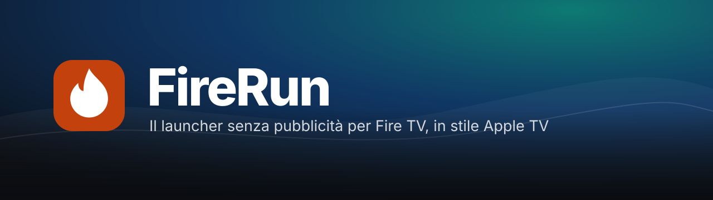
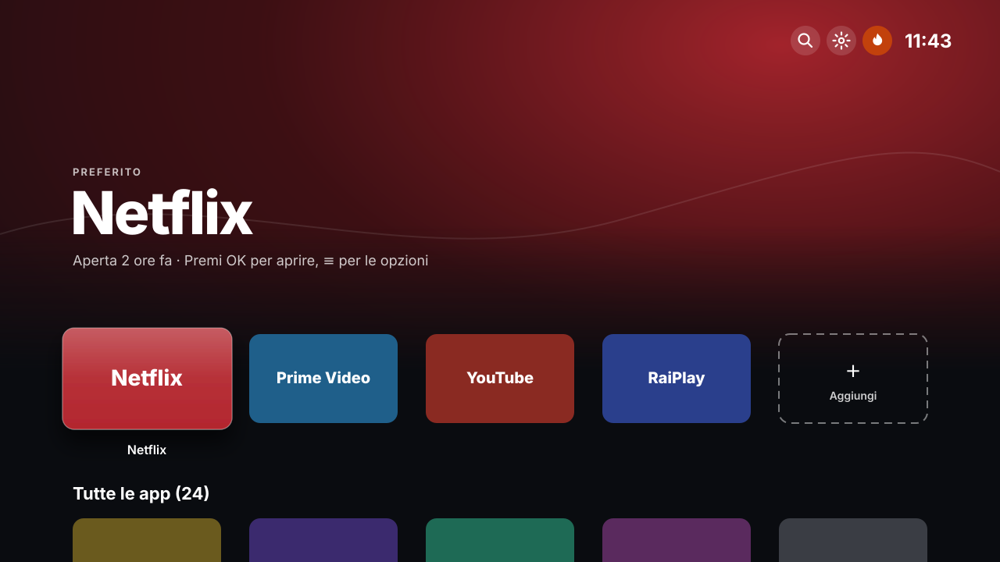

<p align="center">
  
</p>

<p align="center">
  <a href="https://github.com/Kyo89-sudo/FireRun/releases/latest"></a>
  <a href="https://github.com/Kyo89-sudo/FireRun/actions/workflows/build.yml"></a>
  
  
</p>

**FireRun** sostituisce la home del Fire TV Stick con una schermata pulita in stile Apple TV:
solo le tue app, nessuna pubblicità, nessun contenuto sponsorizzato, nessun autoplay.
Funziona senza root ed è pensato per il **Fire TV Stick 4K Max**, ma va su qualsiasi Fire TV
e Android TV.

<p align="center">
  
</p>

## Funzioni

| | |
|---|---|
| **Top Shelf** | La metà alta mostra l'app selezionata in grande; lo sfondo prende il colore del suo banner. |
| **Griglia stile Apple TV** | Banner 5:3 su 5 colonne. Il riquadro selezionato si solleva con ombra e riflesso e mostra il nome. |
| **Preferiti** | In prima riga le tue app, scelte con il riquadro **Aggiungi** e riordinabili. Sotto, **Tutte le app**. |
| **Menu dell'app** | Tieni premuto OK (o tasto ≡): apri, preferiti, sposta, nascondi, info, disinstalla. |
| **Cerca** | Trova un'app scrivendo il nome. |
| **Sfondi** | Colore dell'app, Sequoia, Notte, Prugna, Grafite oppure **una tua immagine** inviata dal PC. |
| **Tasto Home** | Premendo Home torni a FireRun e non alla home Amazon, che non si vede nemmeno per un istante. |
| **Accensione e standby** | All'avvio e al risveglio compare FireRun. |
| **Aggiornamenti** | Si aggiorna da solo dalle release di GitHub. |
| **Privacy** | Un interruttore nelle Opzioni spegne tracciamento pubblicitario, invio dei dati di utilizzo, video automatici e notifiche a comparsa. Spegnendolo torna tutto com'era. |
| **Pulizia Amazon** | Dal PC disattiva 34 pacchetti di pubblicità, ACR e telemetria, con anteprima e ripristino. Gli aggiornamenti di Fire OS restano attivi. |

## Compatibilità

| Dispositivo | Stato |
|---|---|
| Fire TV Stick 4K Max (2ª gen., Fire OS 8) | ✅ provato |
| Altri Fire TV con Fire OS 7 o 8 | ✅ dovrebbe funzionare |
| Android TV / Google TV | ✅ come launcher normale (Opzioni → Launcher predefinito) |
| Modelli con Vega OS (es. Fire TV Stick 4K Select) | ❌ non installano APK |

## Installazione

### 1. Prepara il Fire Stick (una volta sola)

1. **Impostazioni → La mia Fire TV → Informazioni**: premi 7 volte sul nome del dispositivo
   finché compaiono le **Opzioni sviluppatore**.
2. **Opzioni sviluppatore → Debug ADB**: attivalo.
3. Annota l'**indirizzo IP**: Impostazioni → La mia Fire TV → Informazioni → Rete.

### 2a. Dal PC (consigliato)

Scarica [`tools/deploy.ps1`](tools/deploy.ps1) e, nella stessa cartella, in PowerShell:

```powershell
powershell -ExecutionPolicy Bypass -File .\deploy.ps1 -FireStick 192.168.1.50 -AttivaTastoHome
```

La prima volta sul TV compare **«Consentire debug USB?»**: scegli *Consenti sempre da questo computer*.
Lo script scarica `adb` dal sito ufficiale Google se manca, installa l'ultima versione e attiva il Tasto Home.
In alternativa fai doppio clic su [`tools/deploy.cmd`](tools/deploy.cmd).

### 2b. Dal Fire Stick, con Downloader

Installa **Downloader** dall'Appstore, consentigli di installare app (Opzioni sviluppatore →
Installa app sconosciute) e apri:

```
https://github.com/Kyo89-sudo/FireRun/releases/latest/download/FireRun.apk
```

Per il Tasto Home attiva poi **FireRun – Tasto Home** in Impostazioni → Accessibilità, o usa lo
script dal PC: è l'unico modo per avere anche il ritorno istantaneo.

## Lo script `deploy.ps1`

| Opzione | Cosa fa |
|---|---|
| `-FireStick <IP>` | Si collega e installa l'ultima versione, solo se più nuova di quella presente. |
| `-AttivaTastoHome` | Attiva il servizio Tasto Home, il ritorno istantaneo (`min_futurity=0`), l'avvio all'accensione e il permesso per l'interruttore Privacy. |
| `-Sfondo "C:\…\foto.jpg"` | Invia un'immagine JPG, PNG o WEBP e la imposta come sfondo. |
| `-Pulizia -Anteprima` | Mostra cosa farebbe la pulizia, senza cambiare nulla. |
| `-Pulizia` | Disattiva (non disinstalla) 34 pacchetti Amazon di pubblicità, ACR e telemetria. Prima salva sul PC lo stato attuale; alla fine controlla che Impostazioni, Appstore, tastiera, telecomando e FireRun siano attivi, altrimenti annulla da sé. |
| `-PuliziaProfonda` | Come `-Pulizia`, e in più toglie il funzionamento in sottofondo ai 5 pacchetti che Amazon non lascia disattivare (metrics, crashmanager, rdmapplication, ftvads.deeplinking, csapp). |
| `-Ripristina` | Rimette pacchetti, sottofondo e impostazioni di privacy com'erano prima della pulizia. |
| `-Force` | Reinstalla anche se la versione è la stessa. |
| `-DisattivaHomeAmazon` / `-RiattivaHomeAmazon` | Prova a disattivare la home Amazon. Sconsigliato: su Fire OS 8 contiene anche le Impostazioni. |
| `-Repo utente/nome` | Usa un altro repository per le release. |

Per installare in automatico ogni nuova versione, programma lo script ogni ora:

```
schtasks /create /tn "FireRun deploy" /sc hourly /tr "powershell -NoProfile -ExecutionPolicy Bypass -File C:\percorso\deploy.ps1 -FireStick 192.168.1.50"
```

La pulizia non tocca mai gli aggiornamenti di Fire OS (`forcedotaupdater`, `easyupgrade`, `software.ota`) né i pacchetti indispensabili. Le liste vengono da [dumbtv](https://github.com/humblemuzzu/dumbtv).

## Aggiornamenti

- **Dal Fire Stick:** FireRun controlla le release ogni 2 ore, scarica la nuova versione e chiede
  di confermare **Installa** (Android non consente aggiornamenti silenziosi alle app normali).
  Si disattiva in Opzioni → Aggiornamenti automatici.
- **Dal PC:** `deploy.ps1` installa via ADB senza nessuna conferma sul TV.

## Come funziona il Tasto Home

Fire OS lega il tasto Home al launcher Amazon e non permette di cambiarlo. FireRun usa un servizio
di accessibilità che vede **solo quale schermata è aperta**, non il suo contenuto:

- quando compare la home Amazon (`HomeActivity_vNext`) la copre con un velo e apre FireRun;
- Impostazioni e altre schermate Amazon restano aperte normalmente;
- dopo Home Android ritarda l'apertura delle app di qualche secondo: FireRun la fa partire da un
  allarme di sistema, istantaneo grazie a `min_futurity=0` impostato dallo script;
- al risveglio dallo standby torna FireRun solo se eri sulla home Amazon.

Dalle **Opzioni** (la fiamma in alto a destra) puoi aprire la home Amazon quando ti serve,
disattivare la sostituzione e vedere la diagnostica delle schermate.

## Sviluppo

Il progetto è Java puro con le API di Android, senza librerie esterne.

- **Build:** ogni push su `main` avvia [GitHub Actions](.github/workflows/build.yml), che compila e
  pubblica la release `v1.0.N` con `FireRun.apk` e `version.json`.
- **Firma:** la chiave **non è nel repository**. Va nei *Secrets* del repo (`KEYSTORE_BASE64`,
  `KEYSTORE_PASSWORD`); senza, la build si ferma.
- **In locale:** apri la cartella con Android Studio; per una release firmata imposta
  `FIRERUN_KEYSTORE` e `FIRERUN_KEYSTORE_PASSWORD`.

## Crediti

Il sistema del Tasto Home (riconoscimento esatto della home Amazon, velo, avvio istantaneo,
apertura delle vere Impostazioni) è ripreso da [dumbtv](https://github.com/humblemuzzu/dumbtv),
licenza MIT. Dettagli in [THIRD_PARTY_NOTICES.md](THIRD_PARTY_NOTICES.md).

FireRun non è affiliato ad Amazon né ad Apple. Fire TV è un marchio di Amazon.
